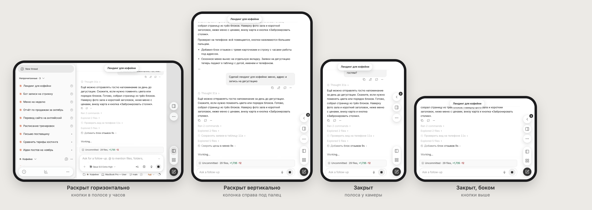
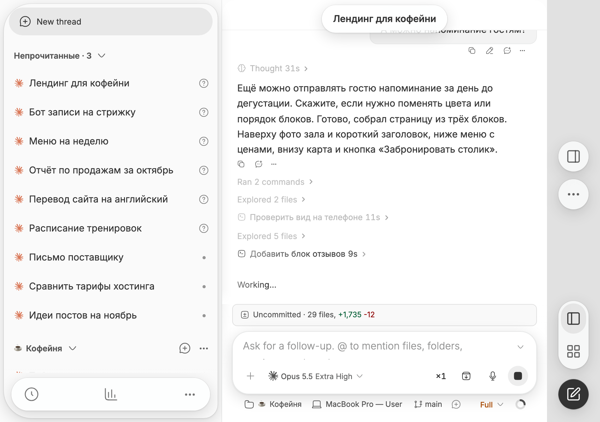
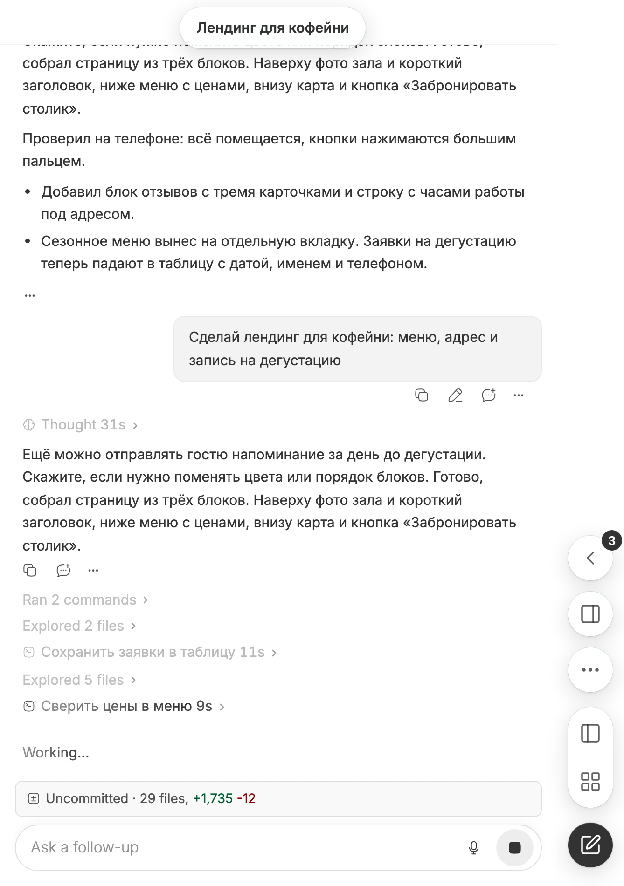
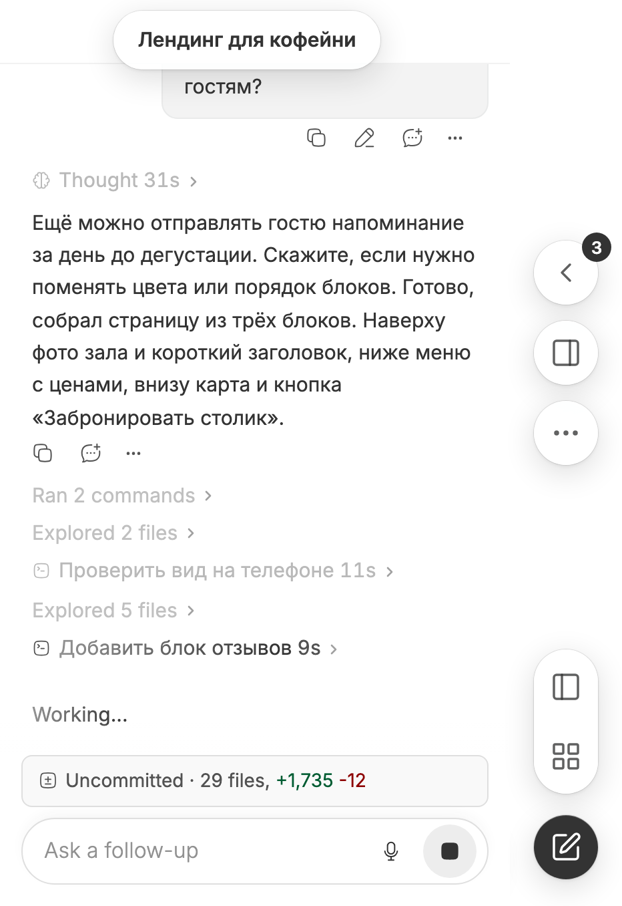
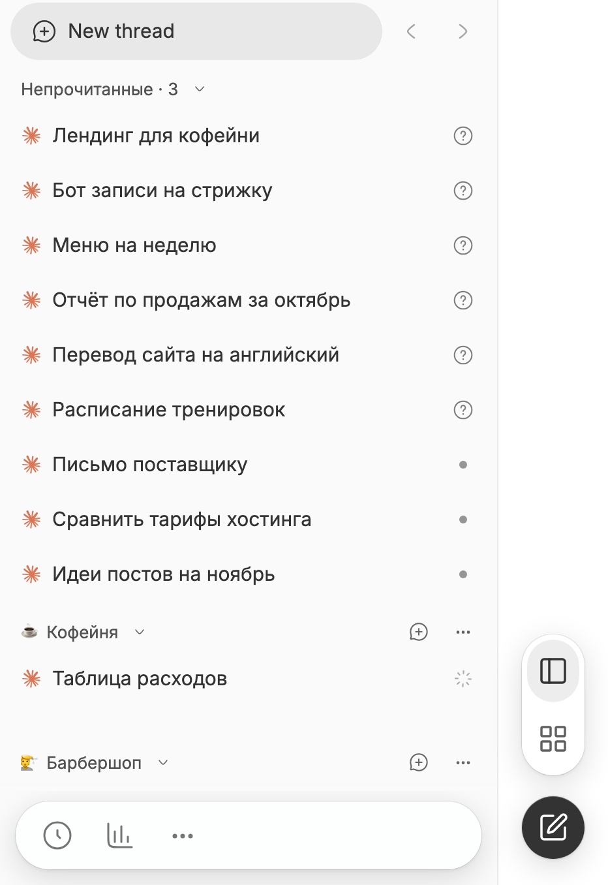
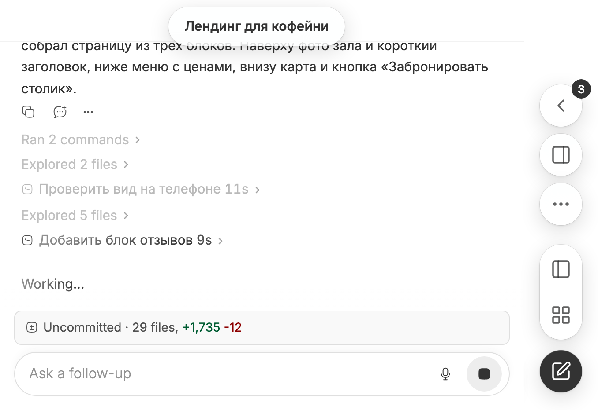

# Duo Layout

bb на iPhone Duo в любом положении телефона. Кнопки стоят у края экрана под
большим пальцем, размеры и форма взяты у нового Telegram (iOS 26), цвета и
шрифт остаются от bb. На маке и в браузере компьютера ничего не меняется.

Положения закрытого и вертикального Duo, кнопку «назад» и пропорции Telegram
сделал [mprilepov](https://github.com/mprilepov) в
[bb-duo-layout](https://github.com/mprilepov/bb-duo-layout); здесь они
объединены с раскладкой раскрытого горизонтального Duo.



## Что в каждом положении

| Положение | Как выглядит |
|---|---|
| **Раскрыт горизонтально** | Список и тред рядом. В полосе у часов круглые стеклянные кнопки: правая панель, архив, «⋯». Ниже вкладки капсулой и «Новый тред» залитым кругом. Название треда по центру в капсуле, внизу списка плавающая панель. |
| **Раскрыт вертикально** | Справа колонка кнопок снизу вверх, под большим пальцем: «Новый тред», вкладки, кнопки треда и «назад». Список во всю ширину до колонки. |
| **Закрыт** | Кнопки в полосе у часов и камеры, текст под камеру не заходит. «Назад» ведёт к списку, меню треда выезжает снизу. |
| **Закрыт и повёрнут боком** | То же, что закрытый. Кнопки подняты выше, потому что экран низкий. |
| **Обычный iPhone стоя** | Кнопка «назад» стеклянным кругом в шапке. |

| Раскрыт горизонтально | Раскрыт вертикально |
|---|---|
|  |  |

| Закрыт: тред | Закрыт: список | Закрыт, боком |
|---|---|---|
|  |  |  |

На снимках вместо настоящих тредов — пример.

## Общее для всех положений

- **Размеры как у Telegram.** Круги у края 48pt, панели 44pt, значки 24pt.
  Текст сообщений и списка 15pt, поле ввода 16pt (так iOS не увеличивает
  страницу). Выпадающие меню bb (меню треда, «+» у поля сообщения, выбор
  модели) — 17pt и строки 44pt.
- **Кнопки у края — собственные элементы плагина.** Они нажимают родные
  кнопки bb, поэтому работают все действия bb. Перенести туда сами кнопки bb
  нельзя: WebKit на телефоне не рисует их за пределами панели треда.
- **«Назад» с числом непрочитанных**, как в Telegram. Число берётся из блока
  «Непрочитанные · N» в списке тредов; его рисует отдельный плагин списка.
  Без него кнопка просто без числа.
- **Вопрос агента над полем ввода не просвечивает** при прокрутке, строка
  под полем (проект, машина, ветка) тоже непрозрачная.
- **Один тред на экране.** На десктопе bb открывает тред во второй панели,
  если строку сайдбара перетащить на тред; пальцем это выходит случайно.
  На касание перетаскивание из сайдбара отключено (тап открывает тред, меню
  строки открывается), а если вторая панель всё же есть (bb помнит раскладку
  между запусками), плагин закрывает лишние и оставляет тред в фокусе.

## Раскрыт горизонтально: подробности

Развёрнутый Duo по классу размера такой же, как iPad (regular × regular),
поэтому раскладка следует iPad-модели iOS 26: колонка списка и тред рядом,
управление на плавающем слое стекла, контент читается под ним.

- **Полоса у часов.** В ландшафте iOS отдаёт строке состояния полосу во всю
  высоту (84pt), и Apple раскладывает в ней бары вертикально. Сверху действия
  треда, внизу вкладки: «Треды» (это главная bb: с другой страницы вкладка
  возвращает домой, дома прячет и показывает список), Todo, «Ещё» (карточка с
  остальными разделами рейла и настройками). Рейл, кнопки шапки и
  переключатель сайдбара при полосе спрятаны: всё это есть в полосе.
- **Полоса с любой стороны.** Если телефон повернуть другой стороной, полоса
  уходит влево, кнопки переезжают туда же.
- **Правая панель — колонка 340pt** рядом с тредом, сайдбар на это время
  уходит целиком и возвращается, когда панель закрыта.
- **Две плавающие панели.** Сайдбар и тред — скруглённые панели на фоне чуть
  темнее сайдбара, с отступом 6pt. Колонка списка 352pt.
- **Углы концентричны экрану**: радиус экрана минус отступ. Apple не
  публикует радиус внутреннего экрана Duo; он подобран по телефону, 50pt, в
  переменной `--duo-screen-radius` в начале `app.css`.
- **Одна кривая движения.** Сайдбар, тред и правая панель двигаются вместе по
  кривой iOS-шторки за 320 мс; содержимое правой панели не перестраивается на
  ходу. Карточка «Ещё» вырастает из своей кнопки. При «Уменьшить движение» в
  iOS анимации выключаются.
- **Свайпы — шаг по ряду из трёх панелей**: сайдбар | тред | правая панель.
  Свайп влево по треду прячет сайдбар, следующий открывает правую панель;
  свайп вправо закрывает правую панель (сайдбар возвращается), следующий
  возвращает сайдбар. Нужен сдвиг от 72pt почти по горизонтали; поля ввода,
  код и таблицы с горизонтальной прокруткой свайп не перехватывают, а
  горизонтальный свайп никогда не срабатывает как тап. Каждый шаг даёт лёгкий
  отклик вибрацией.
- **Поле сообщения — стекло над лентой**: лента прокручивается под ним, у
  нижнего края текст плавно уходит в фон. На низком экране пустое поле в одну
  строку; на главной поле внизу, как в треде.
- **Без лишней работы во время ответа.** Скрипт пропускает изменения внутри
  ленты сообщений (поток ответа меняет её каждый кадр) и не читает геометрию,
  пока она не могла измениться.

Без полосы (iPad) остаётся рейл bb, кнопки шапки в одной стеклянной капсуле.

## Как устроено

- `app.ts` смотрит на ширину экрана и на отступы, которые передаёт приложение
  bb (`window.bb.native.safeArea`; в его WebView `env(safe-area-inset-*)`
  бывает 0), и ставит на страницу метку положения:
  - `data-duo-layout` — раскрыт горизонтально (шире 48rem, сенсорный экран);
  - `data-duo-strip` — есть полоса у края (`data-duo-strip-left`, если она
    слева), её ширина в `--duo-strip`;
  - `data-duo-compact` с `data-duo-strip` — закрыт, кнопки в полосе;
  - `data-duo-compact` с `data-duo-column` — раскрыт вертикально, своя
    колонка 72pt справа;
  - `data-duo-bars` — обычный телефон стоя, кнопки в шапке.
- `app.css` — вид для каждой метки. Размеры собраны переменными в начале
  файла.

Настроек и команд нет. Стили находят разметку bb по `data-*` и
`data-testid`, это не версионируемый API: после обновления bb часть правок
может перестать применяться, тогда этот участок просто выглядит как у bb.

## Разработка

```sh
npm ci
npx tsc --noEmit -p .
bb plugin build duo-layout   # из корня репозитория
bb plugin install ./duo-layout --yes
```
